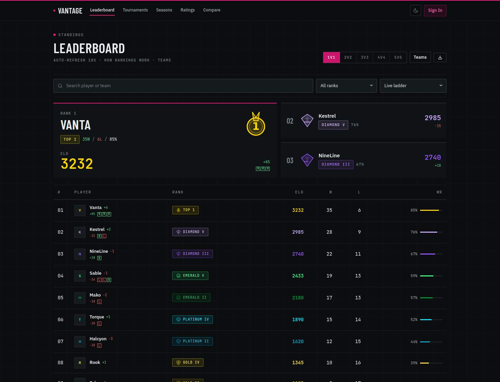

# Vantage 🏆

> **Your community's ranked ladder — up and running in 2 commands.**



A competitive ranking and match-tracking system for **Rainbow Six Siege** built for communities that want to run their own ranked ladder. Features an ELO system with provisional ratings, seasons, tournaments, Discord authentication, and a full admin panel — all wrapped in a tactical match-dossier UI with dark and light themes.

## ✨ What It Can Do

- **ELO Rating System** — Elo with a provisional K that ramps from 64 to 32 over the first 20 matches, new players starting at 500, margin-of-victory weighting, zero-sum deltas (per player in team formats, except at the rating floor), and multi-format support (1v1 through 5v5). Daily decay keeps inactive players from camping the top, can drop them below rank thresholds, and is recorded in rating history. Scores are capped at 20 per side.
- **Player Profiles** — Each player gets a dashboard with ELO history chart, win/loss stats, rank icon, and a feed of their recent matches.
- **Match Reporting** — Report results and let the algorithm handle the math. Configurable score formats for any game mode.
- **Player Comparison** — Put any two players side by side with head-to-head stats and time-filtered match history.
- **Tournaments** — Brackets with visual connector lines, champion highlights, and ELO integration.
- **Seasons** — Time-based resets with archived leaderboards you can browse anytime.
- **Admin Panel** — Manage players, edit matches, set ELO values, bulk import from CSV, add notes, and control seasons. All with an audit log.
- **Discord Auth** — Log in with Discord. Granular admin roles.
- **Rank Icons** — 41 custom SVG icons from Bronze through Champion, each tier with its own distinct shape (shields, crystals, crowns, etc.).
- **Dark Mode** — Moon/sun toggle, saved to your browser. Looks great either way.
- **Download Data** — Export the leaderboard as CSV or JSON with one click.

## 🧱 Tech Stack

| Layer | Tech |
|---|---|
| **Backend** | Python 3.12 + FastAPI |
| **Database** | PostgreSQL 16 via asyncpg + SQLAlchemy (async) |
| **Frontend** | Server-rendered Jinja2 + vanilla JS + Tailwind |
| **Auth** | Discord OAuth2 |
| **Scheduling** | APScheduler for ELO decay |
| **Container** | Docker + Docker Compose |
| **Migrations** | Alembic |

## 🚀 Getting Started

### You'll Need

- Docker & Docker Compose

### Let's Go

```bash
git clone https://github.com/Martty12212/rainbow-leaderboard.git
cd rainbow-leaderboard
docker compose up -d --build
```

Open `http://localhost:8090` and you're live.

### Configuration

Copy `.env.example` to `.env` and fill in your details:

```env
DATABASE_URL=postgresql+asyncpg://rainbow:rainbow@db:5432/rainbow
SECRET_KEY=your-secret-key-here
SITE_NAME=Vantage
COOKIE_SECURE=false          # true behind HTTPS
PUBLIC_BASE_URL=http://localhost:8090
DISCORD_CLIENT_ID=your-discord-client-id
DISCORD_CLIENT_SECRET=your-discord-client-secret
DISCORD_REDIRECT_URI=http://localhost:8090/auth/callback
DISCORD_WEBHOOK_URL=         # optional match announcements
```

To make yourself an admin, add your Discord user ID to `admin_discord_ids` in `app/config.py`.

### Testing without Discord

Real sign-in is Discord OAuth. For a quick local/tailnet test, set
`DEV_LOGIN_DISCORD_ID` (and `DEV_LOGIN_ADMIN=true` if you want admin rights),
restart, then open `/auth/dev`. Unset it for production: while it is set, anyone
who can reach the site can log in as that user.

### Migrations

The schema is managed by Alembic. `alembic upgrade head` runs automatically when the
app starts, using a Postgres advisory lock so multiple workers cannot race.

For a database created before Alembic was wired (tables but no `alembic_version`),
startup adopts it: it verifies that no model columns are missing, converts the known
`matches.tournament_id` column to `uuid`, and stamps the baseline. If anything else
looks stale, startup fails with the missing columns instead of guessing.

```bash
alembic upgrade head          # apply migrations
alembic revision --autogenerate -m "change"
```

Back up the database before the first deploy against an existing volume.

## 🎨 Frontend

Pages are server-rendered Jinja with vanilla JS. Tailwind compiles to a committed
stylesheet at `app/static/css/tailwind.min.css`, so the container needs no Node
build:

```bash
npm install
npm run tw:build   # rebuild after changing templates or input.css
npm run tw:watch   # during development
```

Design tokens and components are documented in `DESIGN.md`; product context is in
`PRODUCT.md`. The theme follows `localStorage`, then the system preference; append
`?theme=light` or `?theme=dark` to force one.

## 📖 API Routes

| Method | Path | Description |
|---|---|---|
| GET | `/leaderboard` | View the leaderboard (live or archived season) |
| GET | `/player/{id}` | Player profile and stats |
| GET | `/team/{id}` | Team roster, rating and matches |
| GET | `/match/{id}` | Single match report |
| GET | `/tournaments` | Tournament listings |
| GET | `/api/leaderboard/{format}` | Standings (`?season=` for archives) |
| GET | `/api/matches` | Match history |
| GET | `/api/matches/{id}` | Match detail |
| POST | `/api/matches/preview` | ELO preview without writing |
| POST | `/api/matches` | Report a match result |
| GET | `/healthz` | Liveness plus database check |

Full API docs at `/docs` (Swagger) or `/redoc`.

## 📁 Project Layout

```
rainbow-leaderboard/
├── app/
│   ├── routers/       # API route handlers
│   ├── templates/     # Jinja2 HTML templates
│   ├── static/        # CSS, icons, avatars
│   ├── config.py      # App configuration
│   ├── database.py    # DB connection & session
│   ├── models.py      # SQLAlchemy models
│   ├── schemas.py     # Pydantic schemas
│   ├── elo.py         # ELO rating logic
│   ├── ranks.py       # Rank definitions
│   └── schema.py      # Alembic bootstrap / adoption
├── alembic/           # Migrations
├── tests/             # Pytest suite
├── main.py            # FastAPI app entrypoint
├── package.json       # Tailwind build
├── Dockerfile         # API container build
├── docker-compose.yml # Service orchestration
└── requirements.txt   # Python dependencies
```

## 📄 License

Built for fun, so go ahead — use it, tweak it, break it, make it yours.
